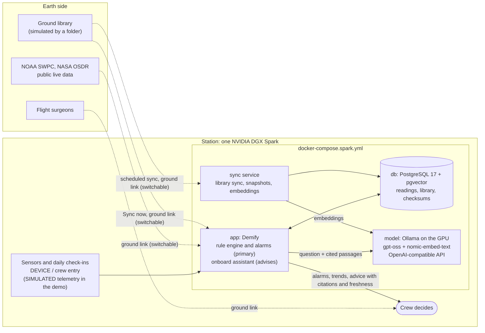

# Demify onboard server: architecture on one page

One NVIDIA DGX Spark (GB10, Arm64, 128 GB unified memory) stands in for the
medical server of a crewed station, with the ISS as the example. Four
containers, one compose file ([`docker-compose.spark.yml`](../docker-compose.spark.yml));
setup in [`SPARK.md`](SPARK.md). Research prototype, not a certified medical
device.

## Data flow

1. **Readings** from sensors (DEVICE), daily check-ins (crew entry) or the
   simulator (SIMULATED) go to the app and into PostgreSQL. The deterministic
   rule engine checks every value against tagged reference ranges and the
   crew member's own baseline, and raises the alarms. This path needs no
   model and no ground link.
2. **Library sync.** While the ground link is up, the sync service pulls the
   curated library (protocols, references, crew baselines, medical-kit
   inventory) into PostgreSQL every 6 hours, splits it into passages, stores
   a SHA-256 per passage and has the embedding model embed them. "Sync now"
   on the Library page does the same at once; the app runs it itself (under
   the same database lock), so it works even while the sync service is
   stopped.
3. **A crew question** goes to the onboard assistant. It finds the best
   passages (vector search, with full-text search as fallback), checks their
   SHA-256, and asks the local language model to answer from those passages
   only. The answer cites every passage it used and says how fresh the
   library is ("last synced 14 hours ago").
4. **Live data** (space weather, NASA OSDR) is fetched while the ground link is
   up and kept as a snapshot for the blackout.

## What is real and what is simulated

| Real | Simulated or representative |
|---|---|
| NOAA SWPC and NASA OSDR data (REAL while the ground link is up, SNAPSHOT with its date otherwise) | Crew vital signs, unless labelled DEVICE or crew entry |
| The local language model and embeddings, running on the Spark's GPU (no cloud service) | The ground link switch (blackout demo) and the Earth-side library server (a folder) |
| PostgreSQL storage, checksums, crash recovery, sync history | Drills and their telemetry |
| Library passages with their sources (project text, not clinically reviewed) | The medical-kit inventory (a representative training list, not the real ISS kit) |
| | The Spark itself: a desktop prototype stand-in, not flight hardware |

## Safety

- **Advises, never decides.** The crew and, when the ground link is up, the
  flight surgeons make every medical decision. The assistant never raises or
  clears an alarm; the rule engine stays primary.
- **Citations.** Every answer cites the library passages it used, with title,
  section, source, review status and version.
- **Freshness.** Every answer shows when the library was last synced and
  whether the ground link is up; an old library is marked stale.
- **No answer instead of a guess.** When the library has no good passage,
  the assistant says so. Without a model it shows the passages only.
- **No medicines.** The library holds no drug names, doses, amounts or
  schedules; such questions are declined.

## Offline-first

| | Ground link up (normal mode) | Ground link down (blackout) |
|---|---|---|
| Alarms and rule engine | Run on board | Run on board, unchanged |
| Onboard assistant | Local model, local library | Local model, local library, with its age |
| Library | Syncs from the ground (schedule, Sync now) | Last synced version; Sync now declined |
| Space weather, OSDR | REAL, live | SNAPSHOT with its date |
| Flight surgeons | Reachable | Crew follows the blackout procedure in the library |

Every part degrades on its own: without the model the assistant shows
passages, without PostgreSQL the app keeps readings in a JSON spool and
replays it later, and every container restarts by itself.

## Where it would run

- **Pitch laptop:** `docker-compose.yml`, no database. The assistant searches
  the library bundled with the release by keywords; an optional small local
  model (`gemma3:4b` with Ollama) writes the answer from the cited passages
  ([`LOCAL-MODEL.md`](LOCAL-MODEL.md)).
- **DGX Spark:** the ground-test and analog-station server, with Asclepios
  (Switzerland) as the pilot candidate we would approach.
- **A real spacecraft:** the same software on an existing approved crew
  laptop or a hosted payload of the Spaceborne Computer-2 class, not a new
  box: power, cooling and approval are the limits. Reasons and sources in
  [`SPARK.md` section 12](SPARK.md#12-does-a-dgx-spark-make-sense).

## What we must not claim

From the team's research notes
([`research/iss-health-equipment.md`](research/iss-health-equipment.md)):

- That Demify connects to any ISS device, laptop, network or data link. It
  does not.
- That NASA, ESA or any agency uses, tests or endorses Demify.
- That Demify is a certified medical device, gives a diagnosis, or replaces
  flight surgeons, Crew Medical Officers or Private Medical Conferences.
- That the vital signs in the demo are real crew data. They are simulated.
- That we know the data formats of ISS medical devices.
- That Docker is approved on ISS laptops.
- That the ISS has "600 Mbps for us": its Ku-band link carries about
  517 Mbps down of user data, shared by the whole station, with gaps.
- Anything about the Crew-11 medical return beyond what NASA and the
  astronaut made public.
- Medicine doses, or that Demify suggests treatment.
- Any item the research marks as unconfirmed, stated as a fact.
