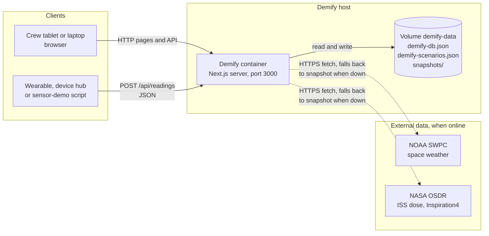
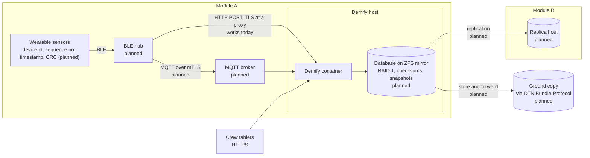
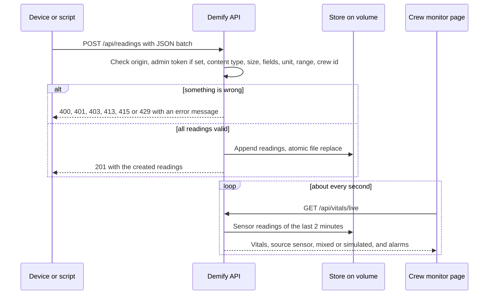
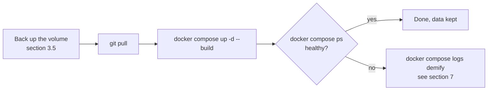
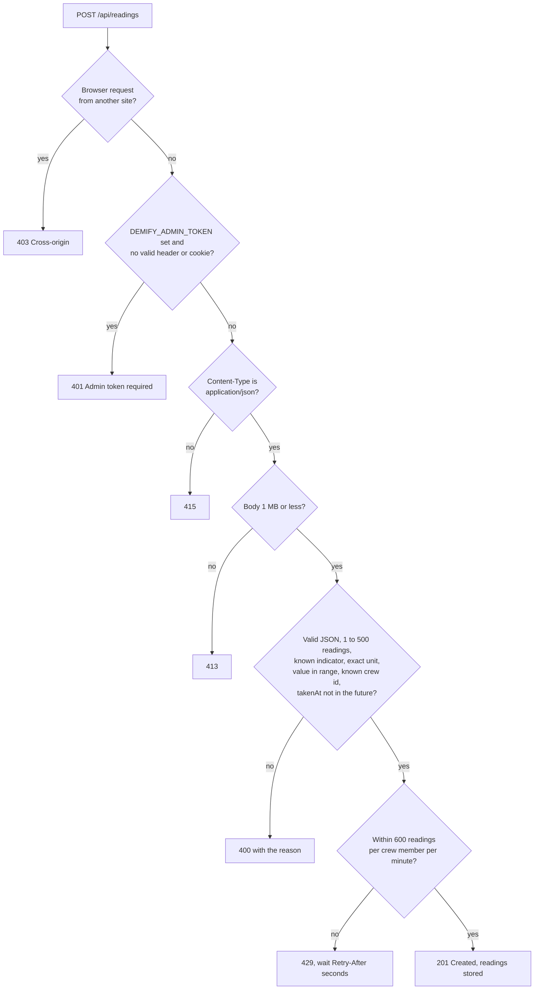
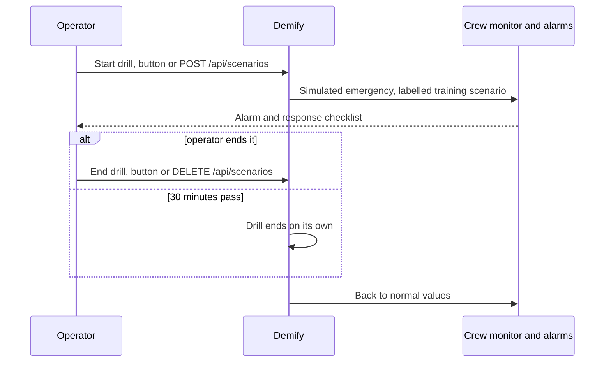
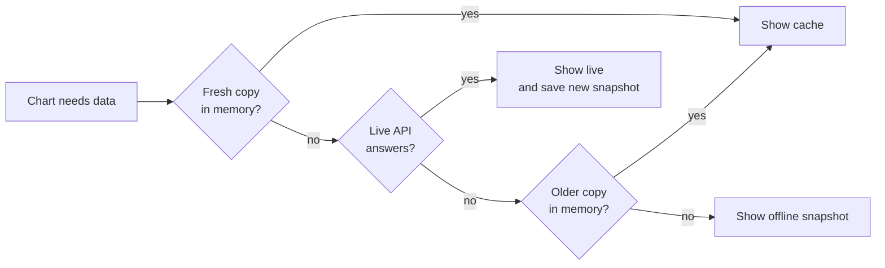

# Demify operations handbook

This handbook is for the people who run Demify: the team during development
and demos, and later an operator on a station or ground network. It covers
starting and stopping the app, keeping its data safe, connecting sensors,
running drills and fixing common problems.

- Crew members using the app: open the **Help** page (`/help`) in the app.
- Deep deployment topics (proxies, ARM builds, TLS, hardening): see
  [`DEPLOYMENT.md`](DEPLOYMENT.md).
- Every setting with comments: [`.env.example`](../.env.example).

> **Research prototype, not a certified medical device.** Demify is research
> and training software for analog and simulated missions; see the intended
> purpose in the [README](../README.md#intended-purpose). In a real situation
> follow your mission's medical procedures and contact your flight surgeon or
> emergency service.

**Contents**

1. [How Demify fits together](#1-how-demify-fits-together)
2. [Quick start in 3 steps](#2-quick-start-in-3-steps)
3. [Daily operation](#3-daily-operation)
4. [Connecting a sensor](#4-connecting-a-sensor)
5. [Running drills](#5-running-drills)
6. [Offline and air-gapped mode](#6-offline-and-air-gapped-mode)
7. [Troubleshooting](#7-troubleshooting)
8. [Configuration reference](#8-configuration-reference)

---

## 1. How Demify fits together

### What runs today

Demify is one Next.js server in one Docker container. It keeps crew readings,
active drills and offline snapshots in a single named volume. Devices and the
crew's browsers talk to it over plain HTTP. Put a reverse proxy in front for
TLS (see [`DEPLOYMENT.md` §8](DEPLOYMENT.md#8-reverse-proxy-and-tls)).



### Target architecture (next steps, not built yet)

For a real station the data path needs to survive lost packets, a failed disk
and a broken Earth link. The diagram below is the **design we are aiming
for**. None of the parts marked "planned" exist in Demify today.



Design rules behind the target architecture:

- **Every reading carries** a device id, a per-device sequence number, a
  timestamp and a CRC. The host accepts each `(device, seq)` pair once, so a
  sensor can resend after a lost acknowledgement without creating duplicates.
- **A replica is not a backup.** RAID 1 and a replica in another module protect
  against a dead disk or a dead module, but they copy mistakes and corruption
  just as fast. Backups are ZFS checksums plus snapshots on the host and a
  copy on the ground.
- **Earth link over DTN.** The Bundle Protocol stores data and forwards it when
  a contact window opens, instead of failing on a link with up to about
  22 minutes of one-way delay, or no link at all.

| Area | What Demify implements today | Target / next step |
|---|---|---|
| Device ingest | `POST /api/readings` over HTTP, JSON, zod-validated, rate limited per crew member | MQTT broker, mutual TLS with one certificate per device |
| Duplicates | None: a resent request is stored twice | Idempotency on `(device, seq)` |
| Storage | One JSON file (`demify-db.json`) on the `demify-data` volume, written atomically | SQLite or PostgreSQL with replication to a second module |
| Disk safety | Whatever the host disk offers | ZFS mirror (RAID 1) with checksums and snapshots |
| Backup | Manual volume backup with `tar` ([§3.5](#35-backup-and-restore)) | Scheduled snapshots plus a ground copy |
| Earth link | Live NOAA / NASA fetch with offline snapshots as fallback | DTN Bundle Protocol to and from ground |
| Deployment | Docker image, Compose, air-gapped `offline` profile | Same image on flight hardware (ARM build is supported) |
| Alarms and drills | Training alarms styled after IEC 60601-1-8, drills with auto-end | Unchanged |
| Access control | Compose binds to `127.0.0.1` by default; optional admin token for the write APIs (`DEMIFY_ADMIN_TOKEN`, [§3.7](#37-stage-and-shared-networks)); anything more at proxy or network level | Authentication at the station gateway |

### How one reading flows through Demify today



---

## 2. Quick start in 3 steps

You need Docker. Nothing else has to be installed to run Demify.

### Windows (Git Bash and Docker Desktop)

1. **Install the tools.** Install [Git for Windows](https://git-scm.com/download/win)
   (includes Git Bash) and [Docker Desktop](https://www.docker.com/products/docker-desktop/)
   with the WSL 2 backend. Start Docker Desktop and wait until it says it is
   running. Then open a **new** Git Bash window and check:

   ```bash
   docker --version
   docker compose version
   ```

2. **Get the code.**

   ```bash
   git clone https://github.com/Duesi09/Demify---Health-Monitoring-Software-for-Astronauts.git demify
   cd demify
   ```

3. **Start Demify.**

   ```bash
   docker compose up -d --build
   start http://localhost:3000
   ```

> **Git Bash and paths.** Git Bash rewrites arguments that start with `/` into
> Windows paths, which breaks commands such as `-v demify_demify-data:/data`.
> Run `export MSYS_NO_PATHCONV=1` once in every Git Bash window before any
> command that passes a container path (anything with `/data`, `/app/...`,
> `docker compose exec ...`, `docker cp ...`, backup, restore and reset).
> `docker compose up` and `curl` work without it.

### Linux (Docker Engine)

1. **Install the tools.** Install Docker Engine with the Compose plugin
   ([docs.docker.com/engine/install](https://docs.docker.com/engine/install/))
   and Git. To run `docker` without `sudo`, add yourself to the `docker`
   group and log in again: `sudo usermod -aG docker "$USER"`.

   ```bash
   docker --version
   docker compose version
   ```

2. **Get the code.**

   ```bash
   git clone https://github.com/Duesi09/Demify---Health-Monitoring-Software-for-Astronauts.git demify
   cd demify
   ```

3. **Start Demify.**

   ```bash
   docker compose up -d --build
   xdg-open http://localhost:3000
   ```

The first build takes a few minutes. Later starts take seconds.

### First-run checklist

- [ ] `docker compose ps` shows `demify` with `(healthy)`. This takes about
      20 seconds after the start.
- [ ] `curl http://localhost:3000/api/health` answers
      `{"status":"ok","mission":"iss","offline":false,"time":"..."}`.
- [ ] http://localhost:3000 shows the **Overview** with four crew members.
- [ ] Open a crew member's monitor (**Crew monitor** in the navigation, or a
      crew card). The waveforms move, the monitor is labelled **Simulated
      training monitor**, and vitals are labelled **SIMULATED** until a sensor
      is connected.
- [ ] **Enable alarm sound.** Browsers block sound until you interact with
      the page. When an alarm bar appears, click **Enable alarm sound** in it.
      Check that the computer's volume is up.
- [ ] Optional: send test readings with `npm run sensor:demo` (needs Node 20
      or newer on the machine, see [§4.6](#46-sensor-demo-script)) and watch
      the monitor switch from simulated to sensor values.
- [ ] For a real mission, set `DEMIFY_MISSION` and `DEMIFY_MISSION_START` in
      `.env` (see [§8](#8-configuration-reference)) and restart.

### Without Docker (development)

Needs Node 24 (Node 20 or newer works for the scripts).

```bash
npm install
npm run dev          # http://localhost:3000, data in ./data
npm test             # unit tests
```

Behind an HTTP proxy start the server with `NODE_USE_ENV_PROXY=1 npm run dev`.

---

## 3. Daily operation

All commands run in the repository folder (where `docker-compose.yml` is).
If you changed the port with `DEMIFY_PORT`, use that port instead of 3000.

### 3.1 Start, stop, restart

| Task | Command |
|---|---|
| Start (or apply changed `.env` settings) | `docker compose up -d` |
| Stop, keep all data | `docker compose down` |
| Restart the app only | `docker compose restart demify` |
| Status and health | `docker compose ps` |
| **Delete everything, including all crew data** | `docker compose down -v` |

The container restarts on its own after a crash or a reboot of the host
(`restart: unless-stopped`), as long as Docker itself starts with the system.

### 3.2 Update to a new version



```bash
git pull
docker compose up -d --build
docker compose ps
```

The data volume is kept across updates. To go back to an earlier version,
check out that commit or tag (`git checkout <tag>`) and run
`docker compose up -d --build` again.

### 3.3 Logs and health check

```bash
docker compose logs -f demify            # follow the log, Ctrl+C to leave
docker compose logs --tail 100 demify    # last 100 lines
curl http://localhost:3000/api/health    # {"status":"ok",...}
docker inspect --format '{{.State.Health.Status}}' demify   # healthy
```

Docker runs the same health check every 30 seconds. Logs rotate at 3 files of
10 MB each.

### 3.4 Where the data lives

| What | Docker | Local `npm run dev` |
|---|---|---|
| Crew readings (check-ins and sensor data) | volume `demify_demify-data`, file `/data/demify-db.json` | `data/demify-db.json` |
| Active drills | `/data/demify-scenarios.json` | `data/demify-scenarios.json` |
| Refreshed offline snapshots | `/data/snapshots/` | `data/runtime/snapshots/` |
| Snapshots bundled with the release | inside the image, `/app/data/snapshots-seed/` | `data/snapshots/` (committed) |

Compose fixes the project name to `demify`, so the volume is always called
`demify_demify-data` (the offline profile uses `demify_demify-offline-data`).
Check with `docker volume ls`. Look inside with:

```bash
docker compose exec demify ls -la /data /data/snapshots
```

### 3.5 Backup and restore

The backup streams the volume through a temporary Alpine container into a
file in the current folder. It is safe while Demify runs, because the store
replaces its file atomically. In Git Bash run `export MSYS_NO_PATHCONV=1`
first.

**Backup**

```bash
docker run --rm -v demify_demify-data:/data alpine \
  tar czf - -C /data . > demify-data-$(date +%F).tgz
tar tzf demify-data-$(date +%F).tgz     # check: lists ./demify-db.json, ./snapshots/...
```

**Restore** (stop the app first, so it does not write over the restored file)

```bash
docker compose stop demify
docker run --rm -i -v demify_demify-data:/data alpine \
  sh -c 'tar xzf - -C /data && chown -R 1001:1001 /data' < demify-data-2026-11-14.tgz
docker compose start demify
```

Replace the file name with your backup. The `chown` matters: the app runs as
user 1001 and must be able to write the restored files.

Keep backups somewhere other than the Demify host. A copy on the same disk
does not survive that disk.

> **No internet on the host?** `alpine` is pulled from Docker Hub the first
> time. Either bring it along (`docker save alpine | gzip > alpine.tgz` on a
> connected machine, `docker load < alpine.tgz` on the host), or use the
> Demify image, which contains `tar` too:
> `docker run --rm --user 0 --entrypoint tar -v demify_demify-data:/data demify:latest czf - -C /data . > demify-data-$(date +%F).tgz`

### 3.6 Reset demo data

This removes all stored readings and drills but keeps the snapshots. The four
default crew members come back on the next start.

```bash
docker compose stop demify
docker run --rm -v demify_demify-data:/data alpine \
  rm -f /data/demify-db.json /data/demify-scenarios.json
docker compose start demify
```

For a complete reset (also refreshed snapshots, which are seeded again from
the image): `docker compose down -v && docker compose up -d`.

Local development: stop `npm run dev`, delete `data/demify-db.json` and
`data/demify-scenarios.json`, start again.

### 3.7 Stage and shared networks

On a stage, at a demo table or on any shared Wi-Fi, assume someone else can
reach the laptop. Two settings keep strangers from starting drills or
posting readings.

**1. Loopback binding (default).** Compose publishes the app and the
air-gapped relay on `${DEMIFY_BIND:-127.0.0.1}`, so only the machine that runs
Demify can open it. Keep this default on a stage laptop. For crew tablets or a
sensor hub on a LAN, open it up in `.env`:

```dotenv
DEMIFY_BIND=0.0.0.0
DEMIFY_ADMIN_TOKEN=<long random value>
```

and run `docker compose up -d`. Check what is published with
`docker compose ps` (the `PORTS` column shows `127.0.0.1:3000->3000/tcp` or
`0.0.0.0:3000->3000/tcp`). `npm run dev` is not affected by `DEMIFY_BIND`; it
listens on all interfaces (`next dev -H 127.0.0.1` keeps it local).

**2. Admin token (optional).** Generate a token once, for example with
`openssl rand -hex 24`, and put it in `.env` as `DEMIFY_ADMIN_TOKEN`. Never
commit it. With the token set:

| Request | Without the token | With the token |
|---|---|---|
| `POST /api/scenarios`, `DELETE /api/scenarios` (start, end drills) | `401` with `{"error":"Admin token required. ..."}` | As before |
| `POST /api/readings` (devices) | `401` | As before |
| Pages, `GET` APIs, `/api/health` | Open | Open |

How each client sends the token:

- **Browser** (to start and end drills from the crew monitor): open
  `http://<host>:3000/unlock?token=<token>` once. Demify compares the token
  in constant time, sets an httpOnly, `SameSite=Strict` cookie that holds a
  value derived from the token (not the token itself), valid for 7 days, and
  redirects to the overview. Behind a TLS proxy that sends
  `X-Forwarded-Proto: https`, the cookie is also marked `Secure`. A wrong
  token answers `401` and sets nothing. Without a configured token, `/unlock`
  only redirects to the overview.
- **Devices, gateways and scripts:** send the header
  `x-demify-admin: <token>`:

  ```bash
  curl -X POST http://localhost:3000/api/readings \
    -H 'content-type: application/json' \
    -H "x-demify-admin: $DEMIFY_ADMIN_TOKEN" \
    -d '{"crewId":"cdr","indicator":"heartRate","value":64,"unit":"bpm","source":"sensor"}'
  ```

To lock every browser out again, change the token and run
`docker compose up -d`: cookies issued for the old token stop working. The
browser shows a drill error starting with `Admin token required` when it is
not unlocked.

Limits, so nobody is surprised on stage:

- The daily **check-in** form saves through the app itself (a server action),
  not through `POST /api/readings`, so the token does not cover it. Keep the
  loopback default wherever check-ins must stay private.
- `npm run sensor:demo` does not send the token yet. Leave
  `DEMIFY_ADMIN_TOKEN` empty while you use it, or post with `curl` and the
  header as shown above.
- The token is not a user login and does not encrypt anything. On a real
  network put Demify behind a reverse proxy with TLS
  ([`DEPLOYMENT.md` §8](DEPLOYMENT.md#8-reverse-proxy-and-tls)).

---

## 4. Connecting a sensor

Any device, hub or ground relay that can send an HTTP POST with JSON can feed
Demify. There is no driver to install.

### 4.1 What Demify checks



The whole batch is accepted or rejected together. One bad reading rejects the
batch, and the error message names it (for example `→ at [3].unit`).

### 4.2 Request format

`POST /api/readings` with `Content-Type: application/json`. The body is one
reading object or an array of up to 500.

| Field | Required | Type | Meaning |
|---|---|---|---|
| `crewId` | yes | string | `cdr`, `plt`, `ms1` or `ms2` (default crew) |
| `indicator` | yes | string | Indicator id from the table below |
| `value` | yes | number | Must lie in the indicator's accepted range |
| `unit` | yes | string | Must match the indicator's unit **exactly** |
| `takenAt` | no | ISO 8601 date-time, e.g. `2026-11-14T08:30:00Z` | Measurement time. Default: time of receipt. At most 5 minutes in the future (clock skew) |
| `source` | no | `"sensor"` or `"manual"` | Use `"sensor"` for devices. Default `"manual"` |
| `note` | no | string, up to 500 characters | Free text |

### 4.3 Indicator ids and units

Taken from [`src/lib/health/knowledge.ts`](../src/lib/health/knowledge.ts).
"Accepted range" is the plausibility check of the API, not the normal range.
The normal, caution and critical bands are on the **Guidance** page.

| `indicator` | Meaning | `unit` | Accepted range |
|---|---|---|---|
| `heartRate` | Resting heart rate | `bpm` | 25 to 220 |
| `systolicBP` | Blood pressure, systolic | `mmHg` | 50 to 260 |
| `diastolicBP` | Blood pressure, diastolic | `mmHg` | 30 to 160 |
| `spo2` | Blood oxygen saturation | `%` | 50 to 100 |
| `bodyTemp` | Body temperature | `°C` | 32 to 43 |
| `respRate` | Respiratory rate | `/min` | 4 to 60 |
| `glucose` | Blood glucose (fasting) | `mg/dL` | 20 to 600 |
| `sleepHours` | Sleep last night | `h` | 0 to 16 |
| `mood` | Mood (1 = very low, 10 = great) | `/10` | 1 to 10 |
| `stress` | Stress (1 = calm, 10 = overwhelmed) | `/10` | 1 to 10 |
| `radiationDoseRate` | Radiation dose rate | `mSv/day` | 0 to 1000 |
| `radiationCumulative` | Cumulative effective dose | `mSv` | 0 to 2000 |
| `bodyMassChange` | Body mass change vs pre-flight | `%` | −30 to 30 |
| `boneLoss` | Estimated bone loss rate | `%/month` | 0 to 5 |
| `exerciseMinutes` | Exercise today | `min` | 0 to 400 |
| `hydration` | Water intake today | `L` | 0 to 8 |
| `wbc` | White blood cell count | `×10⁹/L` | 0 to 60 |
| `cabinCO2` | Cabin CO₂ partial pressure | `mmHg` | 0 to 15 |
| `visionChange` | Vision symptoms (0 none – 3 severe) | `/3` | 0 to 3 |
| `stDeviation` | ST segment deviation (ECG) | `mm` | −10 to 10 |

Units with special characters must arrive as UTF-8. If a device cannot send
them, use JSON escapes: `"°C"` is `"\u00b0C"` and `"×10⁹/L"` is
`"\u00d710\u2079/L"`.

### 4.4 Examples

One reading:

```bash
curl -X POST http://localhost:3000/api/readings \
  -H 'content-type: application/json' \
  -d '{"crewId":"cdr","indicator":"heartRate","value":64,"unit":"bpm","source":"sensor"}'
```

A batch from one wearable (one request instead of six):

```bash
curl -X POST http://localhost:3000/api/readings \
  -H 'content-type: application/json' \
  -d '[
    {"crewId":"cdr","indicator":"heartRate","value":64,"unit":"bpm","source":"sensor"},
    {"crewId":"cdr","indicator":"systolicBP","value":118,"unit":"mmHg","source":"sensor"},
    {"crewId":"cdr","indicator":"diastolicBP","value":76,"unit":"mmHg","source":"sensor"},
    {"crewId":"cdr","indicator":"spo2","value":98,"unit":"%","source":"sensor"},
    {"crewId":"cdr","indicator":"respRate","value":14,"unit":"/min","source":"sensor"},
    {"crewId":"cdr","indicator":"bodyTemp","value":36.7,"unit":"\u00b0C","source":"sensor"}
  ]'
```

Success is `201` with `{"created":[...]}`, each reading with its new `id`.
Read data back with `GET /api/readings?crewId=cdr&indicator=heartRate&hours=24`
or check the monitor feed with `GET /api/vitals/live?crewId=cdr`.

### 4.5 Responses, limits and what the monitor shows

| Status | When | What the device should do |
|---|---|---|
| `201` | All readings stored | Continue |
| `400` | Invalid JSON, empty batch or more than 500 readings, unknown indicator, wrong unit, value out of range, unknown `crewId`, `takenAt` more than 5 minutes ahead | Fix the data. Retrying the same request does not help |
| `401` | `DEMIFY_ADMIN_TOKEN` is set and the request has no valid `x-demify-admin` header or unlock cookie ([§3.7](#37-stage-and-shared-networks)) | Send the header with the token |
| `403` | Request carries an `Origin` header from another site (a web page on a different host). Devices and `curl` send no `Origin` | Send from the device, or serve the page from the same host. Behind a reverse proxy, pass the original `Host` header |
| `413` | Body larger than 1 MB | Send smaller batches |
| `415` | `Content-Type` is not `application/json` | Set the header |
| `429` | More than 600 readings for one crew member in the current one-minute window (`DEMIFY_RATE_LIMIT_PER_MIN`) | Wait the number of seconds in the `Retry-After` header, then resend |

Good to know:

- The rate limit counts readings, not requests, per crew member, in a fixed
  one-minute window kept in memory (a restart resets it). A rejected batch is
  not counted.
- Demify does **not** deduplicate yet. If a device resends a request after a
  timeout, the readings are stored twice. Send each batch once, and keep
  `takenAt` set to the real measurement time.
- The live monitor uses sensor readings of heart rate, blood pressure, SpO₂,
  respiration and temperature that are **less than 2 minutes old**. If all six
  are fresh, the monitor source is `sensor`; if only some are, it is `mixed`
  and the rest stay simulated. Send at least every 60 seconds.
- While a drill runs for a crew member, the monitor shows the drill, not the
  sensor values. Sensor readings are still stored.
- With real sensors in use, set `DEMIFY_SIMULATE=false` so no simulated values
  fill the gaps.

### 4.6 Sensor demo script

[`scripts/sensor-demo.mjs`](../scripts/sensor-demo.mjs) pretends to be a
wearable. Every few seconds it posts one batch of heart rate, blood pressure,
SpO₂, respiration and temperature for one crew member with
`"source":"sensor"`. The values are a slow random walk around normal resting
values generated by the script: they are demo data, not measurements, and
they are stored like real sensor readings (use [§3.6](#36-reset-demo-data) to
remove them). It needs Node 20 or newer and no packages.

```bash
npm run sensor:demo                                   # crew cdr, every 5 s, until Ctrl+C
npm run sensor:demo -- --crew ms1 --interval 2        # another crew member, faster
node scripts/sensor-demo.mjs --url http://localhost:3000 --crew plt --count 10
```

| Flag | Default | Meaning |
|---|---|---|
| `--url` | `http://localhost:3000` | Demify base URL |
| `--crew` | `cdr` | Crew id |
| `--interval` | `5` | Seconds between batches (minimum 0.5) |
| `--count` | until Ctrl+C | Number of batches to send |

It prints each response, waits `Retry-After` on `429`, retries network and
server errors with growing pauses (up to 60 s), and stops on other `4xx`
errors because those need a fix. Example output:

```text
sensor-demo: posting demo vitals for crew "ms1" to http://localhost:3000/api/readings every 1 s, 2 batch(es). Ctrl+C stops.
1:17:41 PM  201 created 6  HR 63 bpm, BP 117/75 mmHg, SpO2 98 %, RR 14/min, T 36.7 °C
1:17:42 PM  201 created 6  HR 62 bpm, BP 118/75 mmHg, SpO2 98 %, RR 14/min, T 36.7 °C
sensor-demo: 2 batch(es) accepted.
```

Open that crew member's monitor while it runs: the vitals switch from
simulated to sensor. About 2 minutes after you stop the script they fall back
to simulated.

---

## 5. Running drills

Drills are emergency **training scenarios**. They drive one crew member's
monitor and alarms with a simulated emergency so the crew can practise the
response checklist. Every screen labels them as training scenario, not a real
emergency.

| Type id | Scenario | Button on the crew monitor |
|---|---|---|
| `stemi` | Acute myocardial infarction (STEMI) | Simulate heart attack (STEMI) |
| `vf` | Cardiac arrest (ventricular fibrillation) | Simulate cardiac arrest (VF) |
| `hypertensive-crisis` | Hypertensive crisis | Simulate hypertensive crisis |



**In the app.** Open **Crew monitor**, pick the crew member, scroll to
**Emergency drill**, click a drill button and confirm. **End drill** stops it.

**Through the API.** With `DEMIFY_ADMIN_TOKEN` set, add
`-H "x-demify-admin: $DEMIFY_ADMIN_TOKEN"` to the `POST` and `DELETE` calls
([§3.7](#37-stage-and-shared-networks)); in the browser, open
`/unlock?token=<token>` once.

```bash
# start (one drill per crew member; starting another replaces it)
curl -X POST http://localhost:3000/api/scenarios \
  -H 'content-type: application/json' \
  -d '{"crewId":"plt","type":"stemi"}'

# list active drills
curl http://localhost:3000/api/scenarios

# end the drill of one crew member
curl -X DELETE 'http://localhost:3000/api/scenarios?crewId=plt'

# end all drills
curl -X DELETE http://localhost:3000/api/scenarios
```

A drill ends by itself after **30 minutes**, so a forgotten drill cannot keep
a crew member in alarm. Active drills are saved in `demify-scenarios.json`
and survive a restart.

---

## 6. Offline and air-gapped mode

Every external source (NOAA SWPC, NASA OSDR) has a snapshot file. When the
live source cannot be reached, Demify falls back automatically, and each chart
shows where its data came from: **REAL** with its fetch time (a live fetch or
an in-memory copy of one), or **SNAPSHOT** with its date (the copy on disk).



There are three ways to run without internet:

| Mode | How | Use when |
|---|---|---|
| Automatic fallback | Nothing to do | The link drops now and then |
| Offline setting | `DEMIFY_OFFLINE=true` in `.env`, then `docker compose up -d` | No link at all; avoids waiting for timeouts |
| Air-gapped profile | `docker compose --profile offline up -d --build demify-offline demify-offline-gateway` | Demo or test with no network route at all. Served on port 3001 (`DEMIFY_OFFLINE_PORT`) with its own volume |

Check the air-gapped profile with `curl http://localhost:3001/api/health`,
which reports `"offline":true`.

**Refreshing the bundled snapshots** before a release:

1. Run the app with internet (`npm run dev`) and open **Radiation** and
   **NASA data** so every source is fetched once. Fresh copies land in
   `data/runtime/snapshots/`.
2. Run `npm run snapshots:promote`. It copies the refreshed snapshots into
   `data/snapshots/` and stops at the first corrupt file (fix or delete it
   and run it again).
3. Commit `data/snapshots/` and rebuild the image (`docker compose up -d --build`).

From a running container instead: `docker cp demify:/data/snapshots/. data/snapshots/`.
To push a newer image's snapshots over older ones on a vehicle, start it once
with `DEMIFY_RESEED_SNAPSHOTS=true`. Details:
[`DEPLOYMENT.md` §5](DEPLOYMENT.md#5-offline-and-air-gapped-operation).

---

## 7. Troubleshooting

| Symptom | Likely cause | Fix |
|---|---|---|
| `docker: command not found` | Docker not installed, or the terminal was open before the install | Install Docker Desktop (Windows, macOS) or Docker Engine (Linux), then close and reopen the terminal |
| `Cannot connect to the Docker daemon` / `error during connect` | Docker Desktop or the Docker service is not running | Start Docker Desktop and wait until it is running. Linux: `sudo systemctl start docker` |
| `permission denied ... docker.sock` (Linux) | User not in the `docker` group | `sudo usermod -aG docker "$USER"`, then log out and in |
| `port is already allocated` / `address already in use` | Another program uses port 3000 | Add `DEMIFY_PORT=3010` to `.env`, run `docker compose up -d`, open http://localhost:3010 |
| Demify works on the host, but tablets or sensors on the LAN cannot connect | Compose binds to `127.0.0.1` by default | Set `DEMIFY_BIND=0.0.0.0` (and a `DEMIFY_ADMIN_TOKEN`) in `.env`, run `docker compose up -d` ([§3.7](#37-stage-and-shared-networks)) |
| Starting a drill shows `Admin token required`, or a sensor gets `401` | `DEMIFY_ADMIN_TOKEN` is set | Browser: open `/unlock?token=<token>` once. Device: send `x-demify-admin: <token>`. A changed token needs a new unlock |
| `/bin/sh^M: bad interpreter` or `exec ... no such file or directory` at container start | Old checkout with Windows line endings | Current `.gitattributes` and `Dockerfile` handle this. Run `git pull`, then re-checkout with LF (stash your changes first): `git rm -r -q --cached . && git reset --hard`, then `docker compose build --no-cache && docker compose up -d` |
| Container stays `unhealthy` | Server failed to start, or the data volume is not writable | `docker compose logs demify`. For a bind mount, make it owned by uid 1001 ([`DEPLOYMENT.md` §2](DEPLOYMENT.md#2-what-is-in-the-image)) |
| No alarm sound | The browser blocks audio until you interact, or sound was silenced | Click **Enable alarm sound** in the alarm bar. Check the system volume. A silence lasts 2 minutes |
| Charts say **SNAPSHOT** with a date | No internet from the container, `DEMIFY_OFFLINE=true`, a proxy in between, or the air-gapped profile | Expected offline. Otherwise check `DEMIFY_OFFLINE`, set `DEMIFY_HTTPS_PROXY` if you are behind a proxy ([`DEPLOYMENT.md` §4](DEPLOYMENT.md#4-behind-a-proxy--custom-ca)), and look for `fetch failed` in the logs |
| `401` from the reverse proxy | The proxy requires a login | Use the credentials of your proxy. Demify itself has no login; its own `401` says `Admin token required` (see above) |
| Behind a reverse proxy, starting a drill gives `403 Cross-origin requests are not allowed`, or a check-in does not save (the log mentions `origin` not matching the host) | The proxy does not pass the original `Host` header, so the browser's `Origin` looks foreign | nginx: `proxy_set_header Host $host;` (Caddy does this by default). See [`DEPLOYMENT.md` §8](DEPLOYMENT.md#8-reverse-proxy-and-tls) |
| `403` / `407` from a corporate proxy during `docker compose build` | Build needs the proxy or its CA | See [`DEPLOYMENT.md` §4](DEPLOYMENT.md#4-behind-a-proxy--custom-ca) |
| Sensor readings return `400` | Wrong unit, value out of range, unknown crew id or indicator | Read the `error` text; compare with [§4.3](#43-indicator-ids-and-units) |
| Monitor stays **simulated** although a sensor posts | Readings older than 2 minutes, `takenAt` in the past, or a drill is running | Send at least every 60 s with the current time, end the drill |
| Monitor says **mixed** | Only some of the six vitals are sent | Send heart rate, both blood pressures, SpO₂, respiration and temperature |
| Mission day looks wrong or changes after a restart | `DEMIFY_MISSION_START` not set; the default is "92 days before start-up" | Set `DEMIFY_MISSION_START=2026-09-01` (your date) in `.env` and restart |
| `npm run dev`: every external chart fails with `fetch failed` | Behind a proxy without `NODE_USE_ENV_PROXY=1` | `NODE_USE_ENV_PROXY=1 npm run dev` |
| Backup or restore in Git Bash fails with a path like `C:/Program Files/Git/data` | Git Bash path conversion | `export MSYS_NO_PATHCONV=1`, then run the command again |

---

## 8. Configuration reference

All settings are environment variables. Put them in a `.env` file next to
`docker-compose.yml` (start from `cp .env.example .env`) and apply them with
`docker compose up -d`. The full list with comments is in
[`.env.example`](../.env.example), the reference table in
[`DEPLOYMENT.md` §3](DEPLOYMENT.md#3-configuration-reference).

The ones you are most likely to need:

| Variable | Default | Purpose |
|---|---|---|
| `DEMIFY_MISSION` | `iss` | `iss`, `artemis-lunar` or `mars-transit`. Sets radiation baseline, signal delay, gravity and mission length |
| `DEMIFY_MISSION_START` | 92 days before start-up | Mission start date (`2026-09-01`). Set it for a real mission: the default moves with every restart |
| `DEMIFY_SIMULATE` | `true` | Demo telemetry for vital signs. Set `false` when real sensors are connected |
| `DEMIFY_OFFLINE` | `false` | `true`: never call external APIs, serve snapshots only |
| `DEMIFY_PORT` | `3000` | Port on the host (Compose only) |
| `DEMIFY_BIND` | `127.0.0.1` | Host address the published ports listen on (Compose only). Loopback keeps a stage laptop private; `0.0.0.0` opens Demify to the LAN ([§3.7](#37-stage-and-shared-networks)) |
| `DEMIFY_ADMIN_TOKEN` | empty (off) | When set, drills and `POST /api/readings` need this token ([§3.7](#37-stage-and-shared-networks)) |
| `DEMIFY_RATE_LIMIT_PER_MIN` | `600` | Readings accepted per crew member per minute on `POST /api/readings` |
| `NASA_API_KEY` | `DEMO_KEY` | Key from [api.nasa.gov](https://api.nasa.gov/). `DEMO_KEY` is heavily rate limited |
